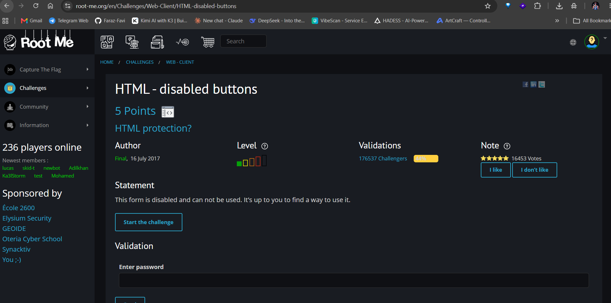
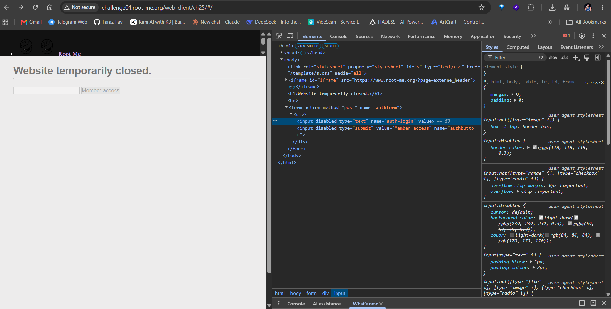
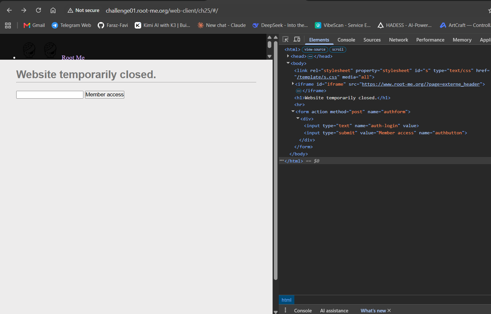
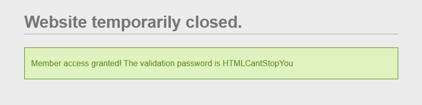
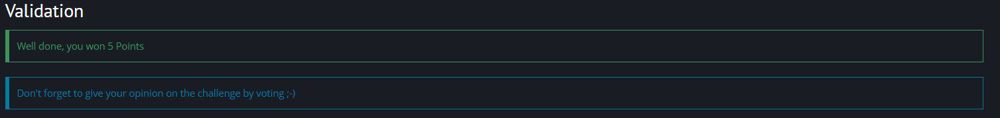

# HTML - Disabled buttons

**Category:** Web-Client · **Points:** 5 · **Author:** Final · **Platform:** [Root-Me](https://www.root-me.org)

---

## 🇬🇧 English

### Statement
The challenge tells us the form on the page is disabled and cannot be used — it's up to us to find a way to use it anyway.



### Approach
Opening the page's HTML source (or the DevTools **Inspector**) shows that both input fields have the `disabled` attribute set:

```html
<input disabled type="text" name="auth-login" value>
<input disabled type="submit" value="Member access" name="authbutton">
```

A `disabled` input can't be focused, typed into, or submitted by the browser — but that's purely a client-side restriction enforced by the DOM, not the server. Using the **Inspector** tab, I removed the `disabled` attribute from both elements directly in the live DOM.



Once removed, the form becomes fully interactive:



Clicking **Member access** (with the field left empty) returns the validation password directly in the page:



### Result


### Takeaway
`disabled` (like `hidden`, client-side `readonly`, or JS-based validation) is a UI-level restriction only. Anything enforced purely in the browser's DOM/CSS can be bypassed by anyone with access to DevTools — real access control must happen server-side.

---

## 🇮🇷 فارسی

### صورت مسئله
توی این چلنج گفته شده که فرم صفحه غیرفعال (disabled) هست و قابل استفاده نیست — وظیفه‌ی ما اینه که یه راهی برای استفاده ازش پیدا کنیم.


### روش حل
اول از همه وقتی سورس کد صفحه رو می‌بینیم (یا از تب **Inspector** دیباگر استفاده می‌کنیم)، متوجه می‌شیم که اینپوت‌های صفحه `disabled` شدن:

```html
<input disabled type="text" name="auth-login" value>
<input disabled type="submit" value="Member access" name="authbutton">
```

این یعنی مرورگر اجازه‌ی کلیک، تایپ یا ارسال این فیلدها رو نمی‌ده، ولی این محدودیت فقط سمت کلاینت (DOM) اعمال شده، نه سرور. با استفاده از تب Inspector، attribute مربوط به `disabled` رو از هر دو المان توی DOM زنده حذف کردم.


بعد از اینکه دیسیبل بودن رو ورمیداریم، فرم باز می‌شه و کاملاً قابل استفاده میشه:


با کلیک روی دکمه‌ی **Member access** (حتی با فیلد خالی)، پسورد اعتبارسنجی مستقیم توی صفحه نمایش داده می‌شه:


### نتیجه


### جمع‌بندی
`disabled` (مثل `hidden`، `readonly` سمت کلاینت، یا اعتبارسنجی با جاوااسکریپت) فقط یه محدودیت در سطح رابط کاربری هست. هر چیزی که صرفاً توی DOM/CSS مرورگر اعمال بشه با دسترسی به DevTools قابل دور زدنه — کنترل دسترسی واقعی باید سمت سرور انجام بشه.
