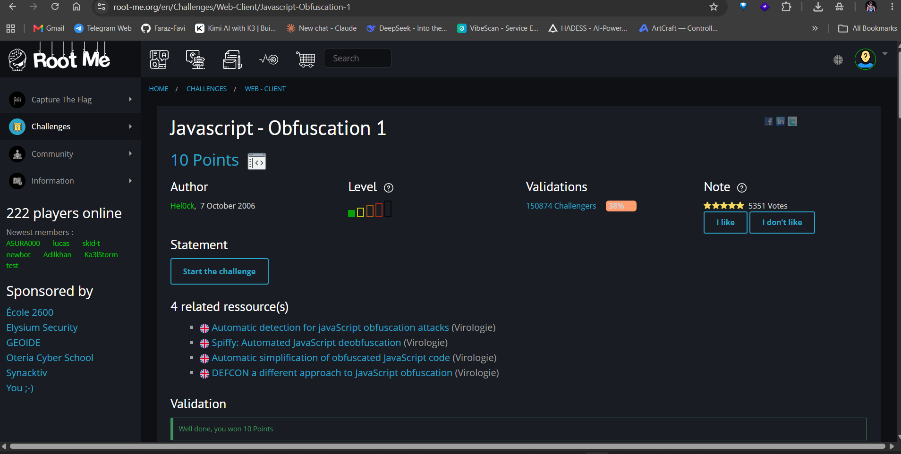
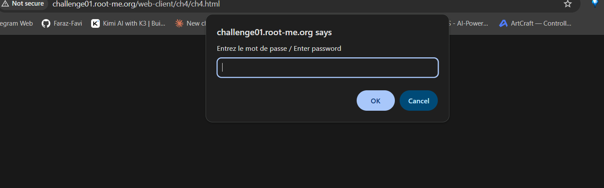
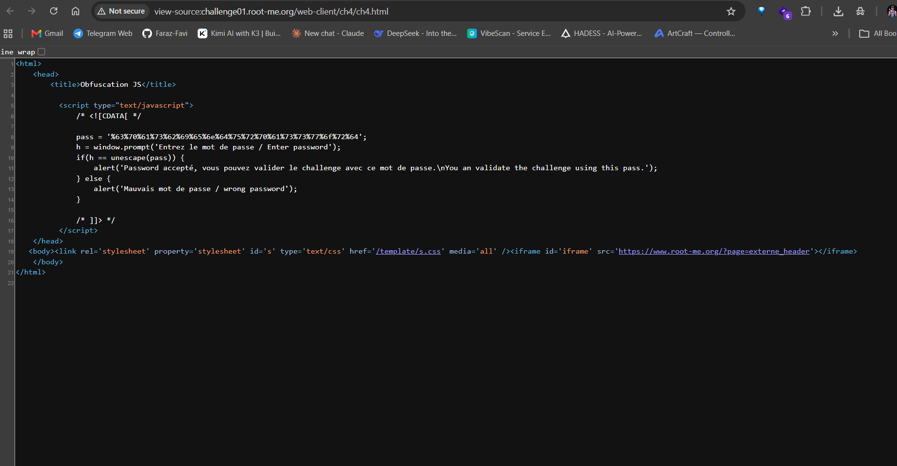
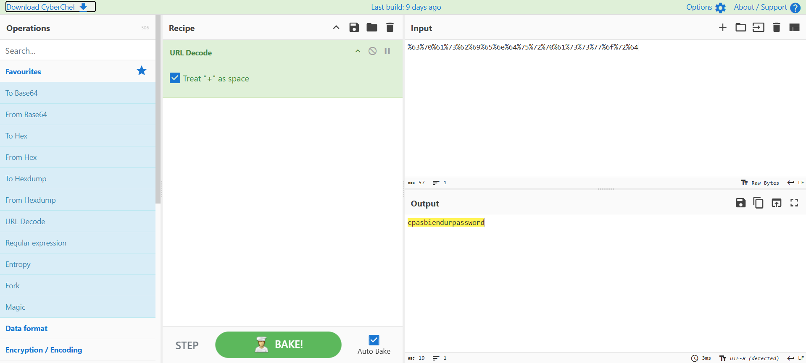
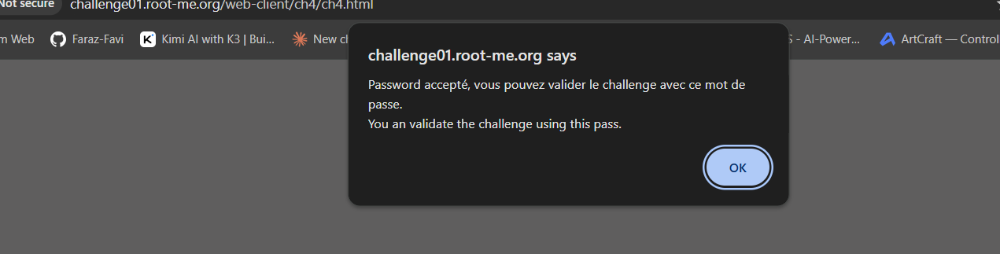
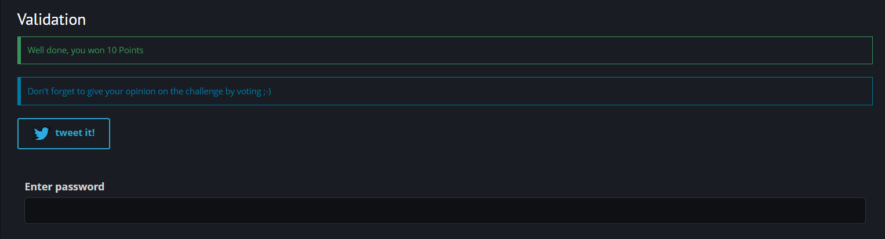

# Javascript - Obfuscation 1

**Category:** Web-Client · **Points:** 10 · **Author:** Hel0ck · **Platform:** [Root-Me](https://www.root-me.org)

---

## 🇬🇧 English

### Statement
The page asks for a password through a JavaScript `prompt()`. No other hint is given.





### Approach
Viewing the page source reveals the validation script. Inside it, a variable holds the expected password — but it's stored URL-encoded (percent-encoded) instead of plain text:

```js
pass = '%63%70%61%73%62%69%65%6e%64%75%72%70%61%73%73%77%6f%72%64';
h = window.prompt('Entrez le mot de passe / Enter password');
if (h == unescape(pass)) { ... }
```

Since the comparison uses `unescape(pass)`, the real password is just the URL-decoded form of that string. I fed the encoded string into **[CyberChef](https://gchq.github.io/CyberChef/)** using the **URL Decode** recipe:





CyberChef instantly returns the clear-text password: `cpasbiendurpassword`. Entering it in the prompt confirms it's correct:



### Result


### Takeaway
URL-encoding (or Base64, hex, etc.) is **encoding, not encryption** — it provides zero confidentiality, only a different text representation. Any secret that only needs to survive a reversible encoding scheme is visible to anyone who reads the client-side source.

---

## 🇮🇷 فارسی

### صورت مسئله
توی این چلنج برای لاگین نیاز به یه پسورد داریم که باید پیداش کنیم. صفحه با یه `prompt()` جاوااسکریپتی ازمون پسورد می‌خواد.


### روش حل
اول از همه که سورس کد رو می‌بینیم، به یه متغیری به نام `pass` برخورد می‌کنیم که مقدار پسورد توش URL-encode شده:

```js
pass = '%63%70%61%73%62%69%65%6e%64%75%72%70%61%73%73%77%6f%72%64';
h = window.prompt('Entrez le mot de passe / Enter password');
if (h == unescape(pass)) { ... }
```

چون مقایسه با `unescape(pass)` انجام میشه، پسورد واقعی فقط حالت دیکودشده‌ی همین رشته هست. از ابزار **[CyberChef](https://gchq.github.io/CyberChef/)** استفاده کردم و با recipe مربوط به **URL Decode**، دیکود رو انجام دادم:


CyberChef بلافاصله پسورد رو به‌صورت متن ساده نشون می‌ده: `cpasbiendurpassword`. حالا به این پسورد دسترسی داریم و با وارد کردنش توی پرامپت، تأیید میشه که درسته:


### نتیجه


### جمع‌بندی
URL-encoding (یا Base64، hex و مشابه اون‌ها) **فقط یه کدگذاریه، نه رمزنگاری** — هیچ محرمانگی واقعی ایجاد نمی‌کنه و صرفاً یه نمایش متنی متفاوت از همون داده‌ست. هر رازی که فقط پشت یه روش کدگذاری قابل‌برگشت باشه، برای هر کسی که سورس کلاینت رو بخونه قابل مشاهده‌ست.
