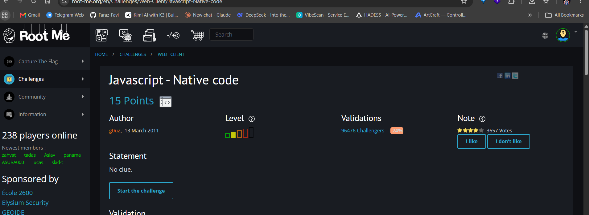
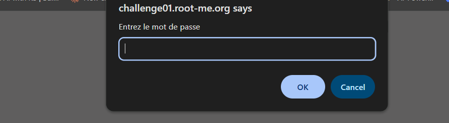
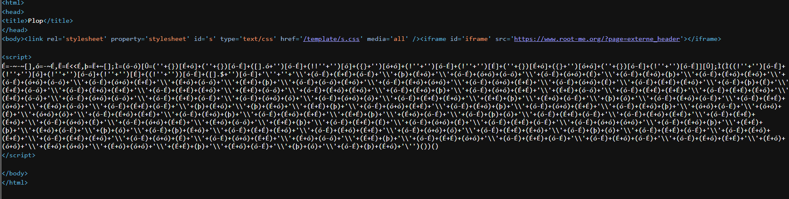
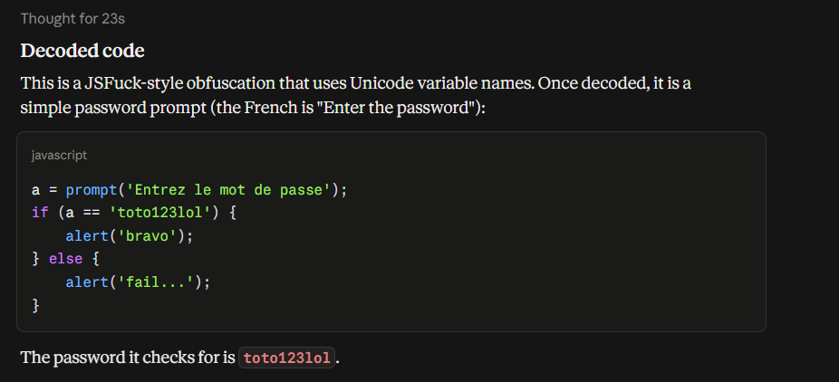
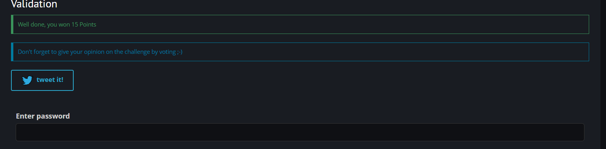

# Javascript - Native code

**Category:** Web-Client · **Points:** 15 · **Author:** g0uZ · **Platform:** [Root-Me](https://www.root-me.org)

---

## 🇬🇧 English

### Statement
"No clue." — the page just asks for a password via a `prompt()`, same pattern as the previous challenge.





### Approach
This time, viewing the source doesn't show readable JavaScript at all — the whole script is obfuscated using the **JSFuck** technique, where the entire program is written using only six characters (`[`, `]`, `(`, `)`, `!`, `+`), combined with Unicode variable names to make it even harder to read:



No automated decoder can usefully "run" this blindly as pasted text, so the process was:

1. First, run the code through a **JS beautifier** to get a clean, properly indented structure. Without this step, no decoder tool can make sense of the layout — JSFuck is a single unbroken expression.
2. Feed the beautified/structured code to an AI assistant (I used Claude) to interpret and decode the logic, since JSFuck ultimately reduces to standard JavaScript operations once unpacked.

The decoded script turned out to be a simple password check:

```js
a = prompt('Entrez le mot de passe');
if (a == 'toto123lol') {
    alert('bravo');
} else {
    alert('fail...');
}
```



The password is `toto123lol`.

### Result


### Takeaway
JSFuck doesn't add real security — it's a pure obfuscation trick that encodes arbitrary JS using a tiny character set. It defeats simple text search / casual reading, but it's still 100% valid, executable JavaScript, so any beautifier + a bit of manual (or AI-assisted) analysis can fully recover the original logic and secrets.

---

## 🇮🇷 فارسی

### صورت مسئله
توی این چلنج هم مثل چلنج قبلی نیاز به یه پسورد برای لاگین داریم. صفحه فقط می‌گه "سرنخی نیست" و با یه `prompt()` پسورد می‌خواد.


### روش حل
وقتی سورس کد رو می‌بینیم، متوجه می‌شیم اسکریپتی نوشته شده ولی با متود **JSFuck** انکود شده — یعنی کل کد فقط با شش کاراکتر (`[`, `]`, `(`, `)`, `!`, `+`) نوشته شده و اسم متغیرها هم از کاراکترهای یونیکد عجیب استفاده می‌کنن که خوندنش رو سخت‌تر می‌کنه:


هیچ دیکودر معمولی نمی‌تونه این متن رو مستقیم و به همین شکل دیکود کنه، برای همین مراحل کار این‌طوری بود:

۱. اول از همه کد رو به یک **JS beautifier** می‌دیم تا استراکچر و فرمت کد مرتب و قابل‌خوندن بشه — بدون این مرحله هیچ ابزار دیکودری قادر به تشخیص ساختار نیست، چون JSFuck یه عبارت پیوسته و بدون شکست‌خطه.
۲. در مرحله‌ی بعد، کد مرتب‌شده رو به یک دستیار هوش مصنوعی (من از Claude استفاده کردم) می‌دیم تا منطق کد رو تحلیل و دیکود کنه، چون JSFuck در نهایت به عملیات استاندارد جاوااسکریپت تبدیل می‌شه.

کد دیکودشده یه بررسی ساده‌ی پسورد از آب در اومد:

```js
a = prompt('Entrez le mot de passe');
if (a == 'toto123lol') {
    alert('bravo');
} else {
    alert('fail...');
}
```


پسورد: `toto123lol`

### نتیجه


### جمع‌بندی
JSFuck امنیت واقعی اضافه نمی‌کنه — فقط یه ترفند obfuscation هست که جاوااسکریپت دلخواه رو با یه مجموعه کاراکتر خیلی کوچیک کدگذاری می‌کنه. این روش جلوی جست‌وجوی متنی ساده یا خوندن سرسری رو می‌گیره، ولی در نهایت یه جاوااسکریپت کاملاً معتبر و قابل‌اجراست، پس با یه beautifier به‌علاوه‌ی کمی تحلیل دستی (یا با کمک هوش مصنوعی) می‌شه کل منطق و رازهای داخلش رو کامل بازیابی کرد.
