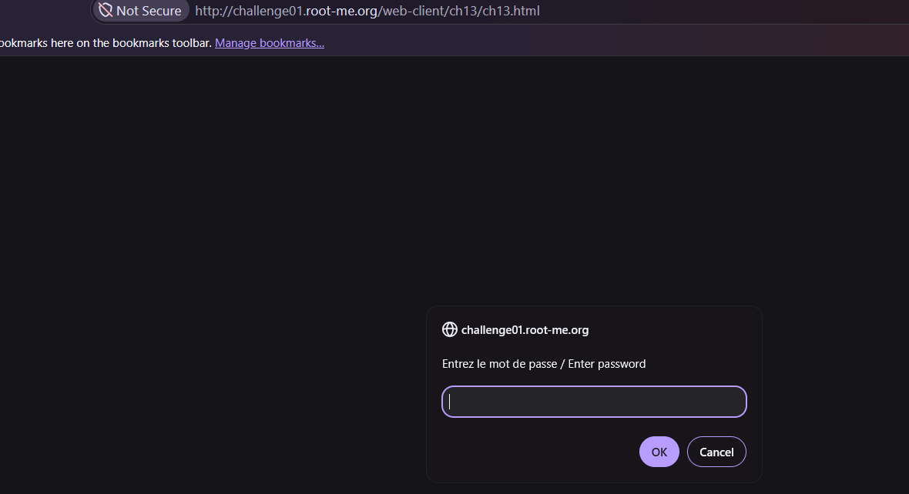
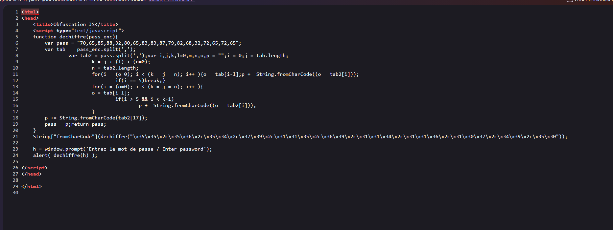
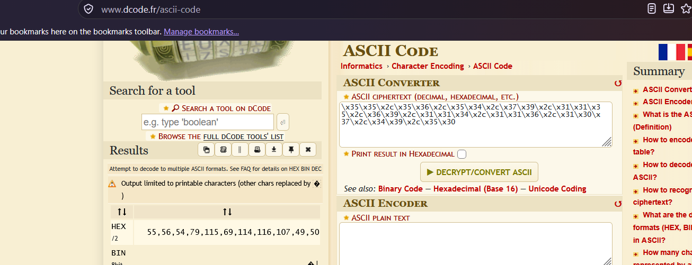
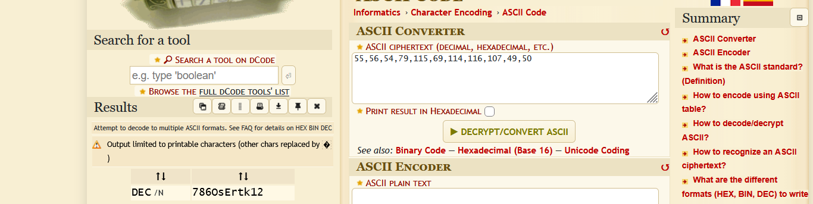
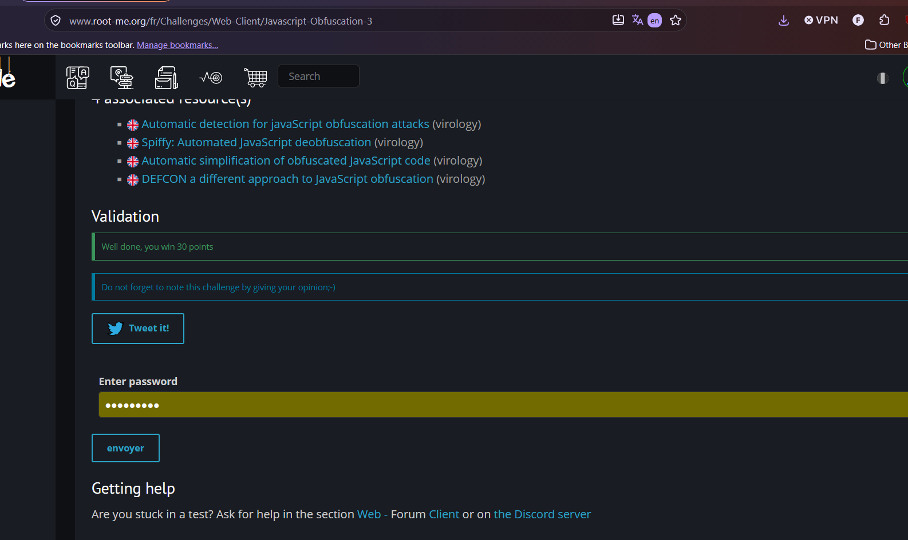

# Javascript - Obfuscation 3

**Category:** Web-Client · **Points:** 30 · **Author:** Helock · **Platform:** [Root-Me](https://www.root-me.org)

---

## 🇬🇧 English

### Statement
"Useful or useless is the question..." — again a password-protected `prompt()`.




### Approach
The page source contains a `dechiffre()` (French for "decrypt") function plus a long comma-separated numeric string passed into it:

```js
function dechiffre(pass_enc){
    var pass = "70,65,85,88,32,80,65,83,83,87,79,82,68,32,72,65,72,69,72,69";
    ...
}
String["fromCharCode"](dechiffre("\x35\x35\x2c\x35\x36\x2c\x35\x34\x2c\x37\x39\x2c\x31\x31\x35\x2c\x36\x39\x2c\x31\x31\x34\x2c\x31\x31\x36\x2c\x31\x30\x37\x2c\x34\x39\x2c\x35\x30"));
```

The important part is simpler than it looks: `dechiffre()`'s internal logic is a red herring / fake decryption on the *first* string (`pass`) — the string that's actually passed in and decoded is the second one, written as **hex-escaped** (`\x35\x35...`) decimal numbers separated by commas.



This means the real secret went through **two layers of encoding**:
1. Each digit of a list of decimal ASCII codes was itself hex-escaped (`\x35` = the character `5`, `\x36` = `6`, etc.)
2. That list of decimal numbers (once read as plain text) are ASCII codes that must be converted to characters.

So the process is: hex-escape → decode to get a literal string of decimal numbers → decode those decimal numbers as ASCII.

Step 1 — decoding the hex escapes with **[dCode's ASCII tool](https://www.dcode.fr/ascii-code)** gives the literal decimal string:



```
55,56,54,79,115,69,114,116,107,49,50
```

Step 2 — feeding that decimal list back into the same ASCII converter resolves each number to its character:



Result: `7860sErtk12`

### Result


### Takeaway
Stacking two trivial, reversible encodings (hex-escape + decimal ASCII) doesn't create real cryptographic strength — it only adds steps for a human reader, while a script (or, just as easily, a generic online decoder used twice) peels each layer off in seconds. The decoy `dechiffre()` function pointing at an unrelated string is a nice reminder to always check *which* value is actually used at runtime, not just which function looks most "important".

---

## 🇮🇷 فارسی

### صورت مسئله
بازم مثل چلنج‌های قبلی، به دنبال یه پسورد هستیم که پشت یه `prompt()` قایم شده.


### روش حل
وقتی سورس کد رو مشاهده می‌کنیم، به یه تابعی به اسم `dechiffre` (یعنی «رمزگشایی» به فرانسوی) برمی‌خوریم که یه رشته‌ی عددی طولانی جدا‌شده با کاما بهش پاس داده می‌شه:

```js
function dechiffre(pass_enc){
    var pass = "70,65,85,88,32,80,65,83,83,87,79,82,68,32,72,65,72,69,72,69";
    ...
}
String["fromCharCode"](dechiffre("\x35\x35\x2c\x35\x36\x2c\x35\x34\x2c\x37\x39\x2c\x31\x31\x35\x2c\x36\x39\x2c\x31\x31\x34\x2c\x31\x31\x36\x2c\x31\x30\x37\x2c\x34\x39\x2c\x35\x30"));
```

نکته‌ی مهم اینه که منطق داخل تابع `dechiffre` مهم نیست، چون این تابع در واقع روی یه رشته‌ی گمراه‌کننده (`pass` بالایی) کار می‌کنه و در نهایت فقط یه خروجی فیک تولید می‌کنه. پسورد اصلی در واقع همون رشته‌ای هست که مستقیماً به تابع پاس داده شده و به‌صورت کدهای **hex-escape** (یعنی `\x35\x35...`) نوشته شده که وقتی دیکود بشه، یه سری عدد دسیمال از آب در میاد.


یعنی پسورد واقعی از **دو لایه‌ی کدگذاری** رد شده:

۱. هر عدد از یه لیست کد ASCII دسیمال، خودش به‌صورت hex-escape نوشته شده (`\x35` یعنی کاراکتر `5`، `\x36` یعنی `6` و الی آخر)
۲. اون لیست عدد دسیمال (وقتی به‌صورت متن ساده خونده بشه) در واقع کد ASCII هست که باید به کاراکتر تبدیل بشه.

پس مسیر درست اینه: دیکود hex-escape → رسیدن به یه رشته‌ی متنی از اعداد دسیمال → دیکود همون اعداد دسیمال به‌عنوان ASCII.

مرحله‌ی اول — دیکود کردن hex-escape ها با ابزار **[dCode ASCII](https://www.dcode.fr/ascii-code)**، که رشته‌ی اعداد دسیمال رو بهمون می‌ده:


```
55,56,54,79,115,69,114,116,107,49,50
```

مرحله‌ی دوم — همین لیست اعداد دسیمال رو دوباره به همون ابزار ASCII می‌دیم تا هر عدد به کاراکترش تبدیل بشه:


نتیجه: `7860sErtk12`

### نتیجه


### جمع‌بندی
روی هم گذاشتن دو تا کدگذاری ساده و قابل‌برگشت (hex-escape + ASCII دسیمال) هیچ قدرت رمزنگاری واقعی اضافه نمی‌کنه — فقط چند مرحله برای یه خواننده‌ی انسانی اضافه می‌کنه، در حالی‌که یه اسکریپت کوچیک (یا حتی همون ابزار آنلاین عمومی که دوبار پشت‌سر‌هم استفاده بشه) در عرض چند ثانیه هر دو لایه رو باز می‌کنه. وجود تابع فریب‌دهنده‌ی `dechiffre` که روی یه رشته‌ی بی‌ربط کار می‌کنه هم یه یادآوری خوبه که همیشه باید چک کنیم کدوم مقدار واقعاً در زمان اجرا استفاده می‌شه، نه اینکه فقط دنبال مهم‌ترین‌به‌نظر‌رسیدن تابع بگردیم.
