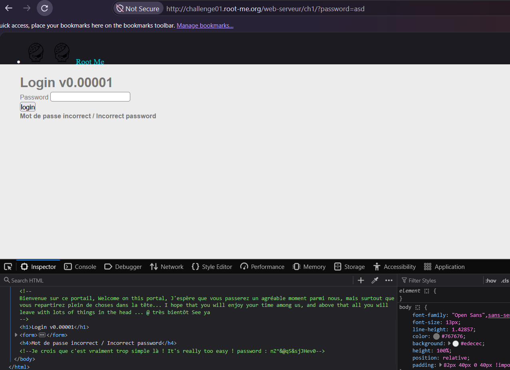
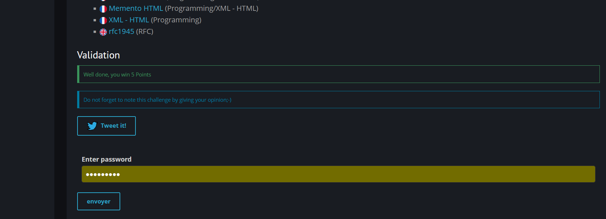

# HTML - Source code

**Category:** Web-Server · **Points:** 5 · **Author:** g0uZ · **Platform:** [Root-Me](https://www.root-me.org)

---

## 🇬🇧 English

### Statement
A simple login form ("Login v0.00001") asks for a password. Submitting a wrong guess just returns "Incorrect password".

### Approach
Opening the page's HTML source (or the DevTools **Inspector**) reveals an HTML comment left in the markup, containing a friendly welcome message in French/English — and, right after it, the validation password in plain text:

```html
<!--
Bienvenue sur ce portail, Welcome on this portal, J'espère que vous passerez un agréable moment...
-->
<h4>Mot de passe incorrect / Incorrect password</h4>
<!--Je crois que c'est vraiment trop simple là ! It's really too easy ! password : nZ^8@q5&sjJHev0-->
```

The developer left a debug/test comment in production containing the real password.



### Result


### Takeaway
HTML comments (`<!-- ... -->`) are stripped by nothing — they are sent to the browser as-is and fully visible to anyone who views the page source. Never leave debug notes, credentials, internal URLs, or TODOs in comments that ship to production.

---

## 🇮🇷 فارسی

### صورت مسئله
یه فرم لاگین ساده («Login v0.00001») داریم که پسورد میخواد - وارد کردن پسورد اشتباه فقط پیام "Incorrect password" رو نشون میده.

### روش حل
وقتی سورس کد پیج رو میبینیم (یا از تب **Inspector** دیباگر استفاده میکنیم) متوجه میشیم که یه کامنت HTML وسط کد گذاشته شده - این کامنت یه پیام خوش‌آمدگویی به فرانسوی/انگلیسی داره و درست بعدش، پسورد اعتبارسنجی به صورت متن ساده نوشته شده:

```html
<!--
Bienvenue sur ce portail, Welcome on this portal, J'espère que vous passerez un agréable moment...
-->
<h4>Mot de passe incorrect / Incorrect password</h4>
<!--Je crois que c'est vraiment trop simple là ! It's really too easy ! password : nZ^8@q5&sjJHev0-->
```

یعنی دولوپر یادش رفته کامنت رو قبل از پابلیش کردن پاک کنه و پسورد همونجا لو رفته.


### نتیجه


### جمع‌بندی
کامنت‌های HTML (`<!-- ... -->`) توسط هیچی حذف نمیشن - دقیقاً همونطوری که نوشته شدن برای مرورگر فرستاده میشن و برای هر کسی که سورس پیج رو ببینه کاملاً قابل مشاهده‌ن. هیچ‌وقت نباید یادداشت دیباگ، پسورد، آدرس داخلی یا TODO رو توی کامنت‌هایی که روی نسخه‌ی نهایی (production) قرار می‌گیرن جا گذاشت.
