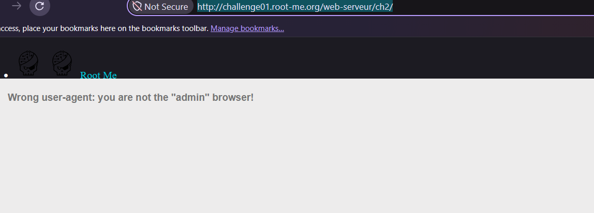
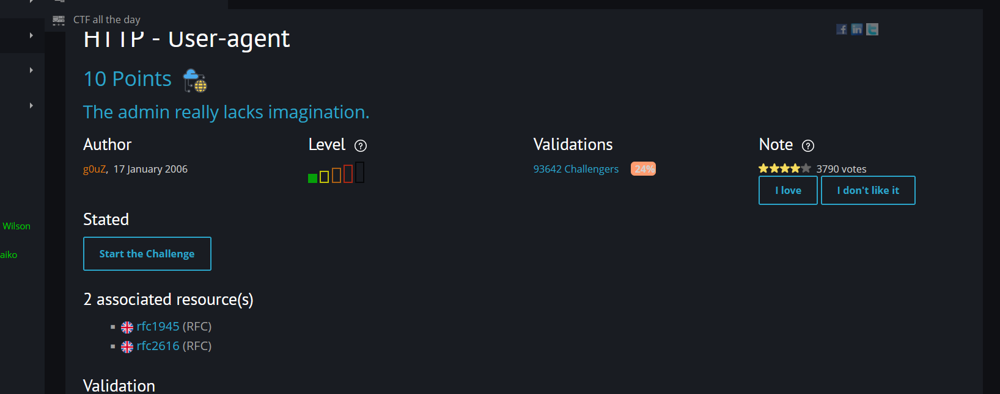
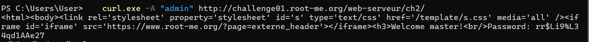
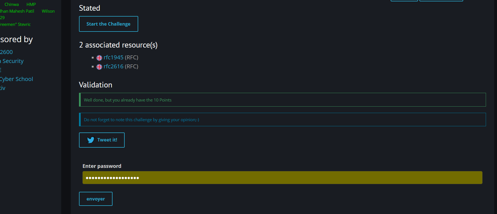

# HTTP - User-agent

**Category:** Web-Server · **Points:** 10 · **Author:** g0uZ · **Platform:** [Root-Me](https://www.root-me.org)

---

## 🇬🇧 English

### Statement
"The admin really lacks imagination." Opening the challenge URL in a normal browser just returns:

> Wrong user-agent: you are not the "admin" browser!





### Approach
The server is clearly inspecting the `User-Agent` request header and only serving the real content when it matches a specific expected value. Since the hint says the admin "lacks imagination", the obvious guess is that the server is literally checking for the string `admin`.

Using `curl`, I can set any arbitrary `User-Agent` header with the `-A` flag and send the request directly, bypassing whatever the browser would normally send:

```bash
curl.exe -A "admin" http://challenge01.root-me.org/web-serveur/ch2/
```



The server immediately responds with the welcome message and the password in plain text.

### Result


### Takeaway
HTTP headers like `User-Agent` are entirely client-controlled — a browser sends whatever string it wants, and nothing stops a script, `curl`, or a browser extension from sending a completely different one. Using the `User-Agent` (or any other client-supplied header) as an access-control mechanism provides no real security, since it's trivial to forge.

---

## 🇮🇷 فارسی

### صورت مسئله
«ادمین واقعاً تخیل کمی داره.» وقتی آدرس چلنج رو با یه مرورگر معمولی باز می‌کنیم، فقط این پیام رو میبینیم:

> Wrong user-agent: you are not the "admin" browser!


### روش حل
مشخصه که سرور داره هدر `User-Agent` ریکوئست رو چک میکنه و فقط وقتی مقدارش با یه چیز خاص یکی باشه، محتوای واقعی رو نشون میده - با توجه به سرنخ (ادمین تخیل کمی داره)، حدس اول اینه که سرور دقیقاً دنبال رشته‌ی `admin` میگرده.

با `curl` میشه هر مقدار دلخواهی رو برای هدر `User-Agent` با فلگ `-A` تنظیم کرد و ریکوئست رو مستقیم فرستاد، بدون اینکه به چیزی که مرورگر معمولاً میفرسته وابسته باشیم:

```bash
curl.exe -A "admin" http://challenge01.root-me.org/web-serveur/ch2/
```


همون موقع سرور پیام خوش‌آمدگویی و پسورد رو به صورت متن ساده برمیگردونه.

### نتیجه


### جمع‌بندی
هدرهای HTTP مثل `User-Agent` کاملاً توسط کلاینت کنترل میشن - یه مرورگر هر رشته‌ای که بخواد میفرسته و هیچ چیزی جلوی یه اسکریپت، `curl`، یا یه اکستنشن مرورگر رو نمیگیره که مقدار کاملاً متفاوتی بفرسته. استفاده از `User-Agent` (یا هر هدر دیگه‌ای که کلاینت می‌فرسته) به‌عنوان یه مکانیزم کنترل دسترسی، هیچ امنیت واقعی ایجاد نمی‌کنه چون جعل کردنش خیلی ساده‌ست.
