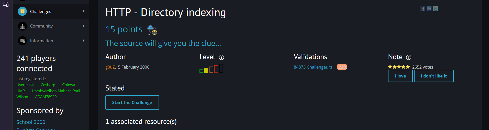
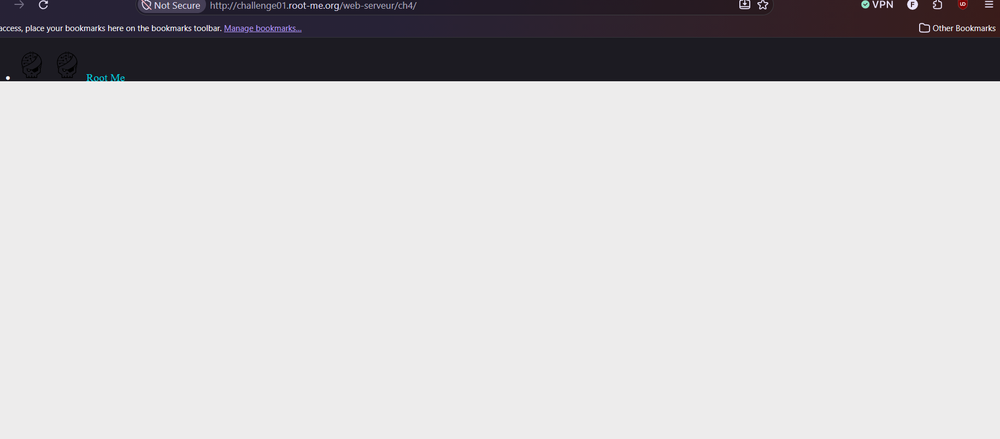
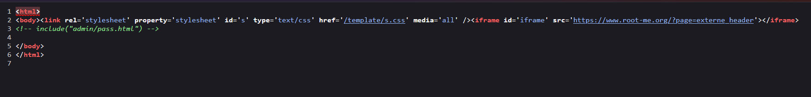
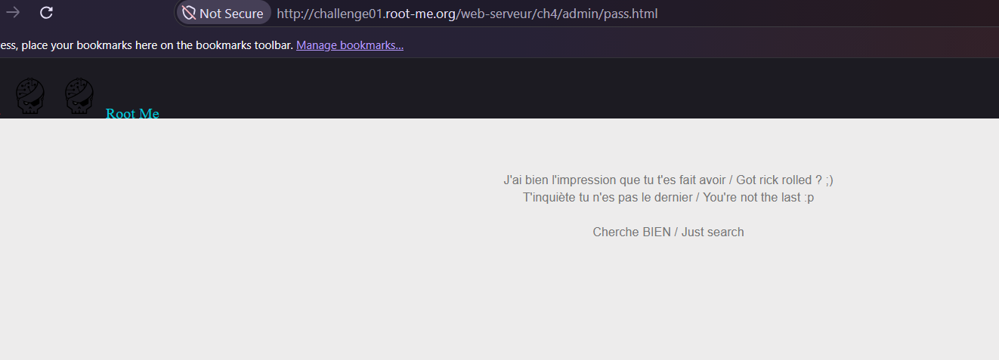
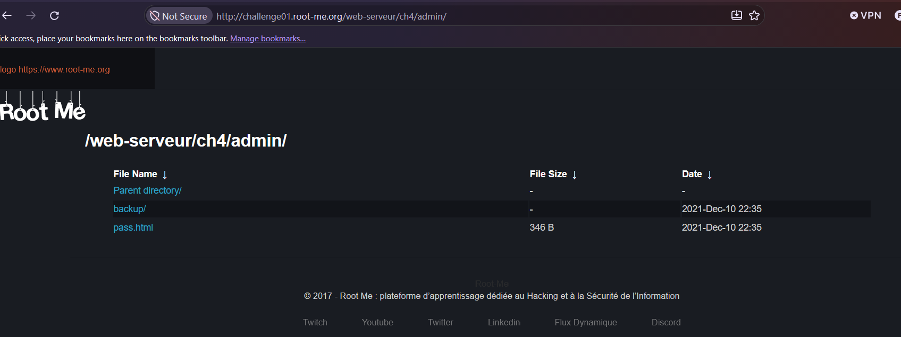
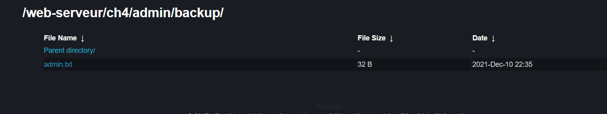
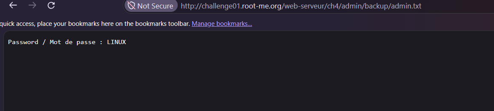

# HTTP - Directory indexing

**Category:** Web-Server · **Points:** 15 · **Author:** g0uZ · **Platform:** [Root-Me](https://www.root-me.org)

---

## 🇬🇧 English

### Statement
"The source will give you the clue..." The challenge page itself renders completely blank.





### Approach
As hinted, the answer is in the source. Viewing the page's HTML reveals a server-side include comment referencing an admin path:

```html
<!-- include("admin/pass.html") -->
```



Navigating directly to `/web-serveur/ch4/admin/pass.html` doesn't give the password — instead it's a decoy/troll page:

> J'ai l'impression que tu t'es fait avoir / Got rickrolled? ;)
> T'inquiète tu n'es pas le dernier / You're not the last :p
> Cherche BIEN / Just search



So the hint `pass.html` itself was a trap. Going one level up to the parent `admin/` directory instead of the specific file, **directory indexing (autoindex)** turns out to be enabled on the server — it lists the full contents of the folder instead of returning a 403/404:



Inside, there's a `backup/` folder — browsing into it (again thanks to indexing being enabled) reveals a stray `admin.txt` file:



Opening that file directly gives the real password.



### Result
Password: `LINUX`

### Takeaway
Two separate mistakes stack up here: (1) a comment in the page source reveals the existence of an internal `admin/` path that should never have been exposed to the client, and (2) **directory indexing being enabled** on that path means anyone can simply browse and discover any file left inside it — including forgotten backups. Web servers should have autoindex disabled by default, and backup files should never be stored inside a publicly reachable web root at all.

---

## 🇮🇷 فارسی

### صورت مسئله
«سورس کد بهت سرنخ رو میده...» خود صفحه‌ی چلنج کاملاً خالی نمایش داده میشه.


### روش حل
همون‌طور که سرنخ گفته، جواب توی سورس کده - وقتی HTML صفحه رو میبینیم یه کامنت مربوط به include سمت سرور میبینیم که به یه مسیر ادمین اشاره میکنه:

```html
<!-- include("admin/pass.html") -->
```


وقتی مستقیم به آدرس `/web-serveur/ch4/admin/pass.html` میریم، پسورد رو نمیده - به جاش یه صفحه‌ی طعمه/شوخی نشون میده:

> J'ai l'impression que tu t'es fait avoir / ریک‌رول شدی؟ ؛)
> T'inquiète tu n'es pas le dernier / نگران نباش، تو آخرین نفر نیستی :پ
> Cherche BIEN / بازم بگرد


یعنی خود فایل `pass.html` یه تله بوده - برمیگردم به یه سطح بالاتر یعنی پوشه‌ی `admin/` به‌جای فایل خاص، و اینجا مشخص میشه که **directory indexing (لیست خودکار فایل‌ها)** روی سرور فعاله - یعنی به‌جای برگردوندن خطای 403/404، کل محتوای پوشه رو نشون میده:


داخلش یه پوشه‌ی `backup/` هست - وارد شدن به اون (بازم به لطف فعال بودن indexing) یه فایل تنها به اسم `admin.txt` رو نشون میده:


باز کردن مستقیم این فایل، پسورد واقعی رو بهمون میده.


### نتیجه
پسورد: `LINUX`

### جمع‌بندی
اینجا دو تا اشتباه جدا روی هم جمع شدن: (۱) یه کامنت توی سورس کد، وجود یه مسیر داخلی `admin/` رو لو داده که اصلاً نباید در معرض کلاینت قرار میگرفت، و (۲) **فعال بودن directory indexing** روی اون مسیر باعث شده هرکسی بتونه به‌راحتی توی پوشه بگرده و هر فایلی که اونجا جا مونده - از جمله بک‌آپ‌های فراموش‌شده - رو پیدا کنه. سرورهای وب باید به‌صورت پیش‌فرض autoindex غیرفعال داشته باشن، و فایل‌های بک‌آپ اصلاً نباید داخل یه مسیر عمومی قابل‌دسترسی روی وب نگه‌داری بشن.
