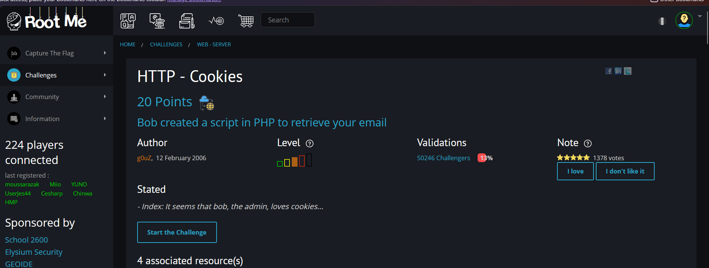
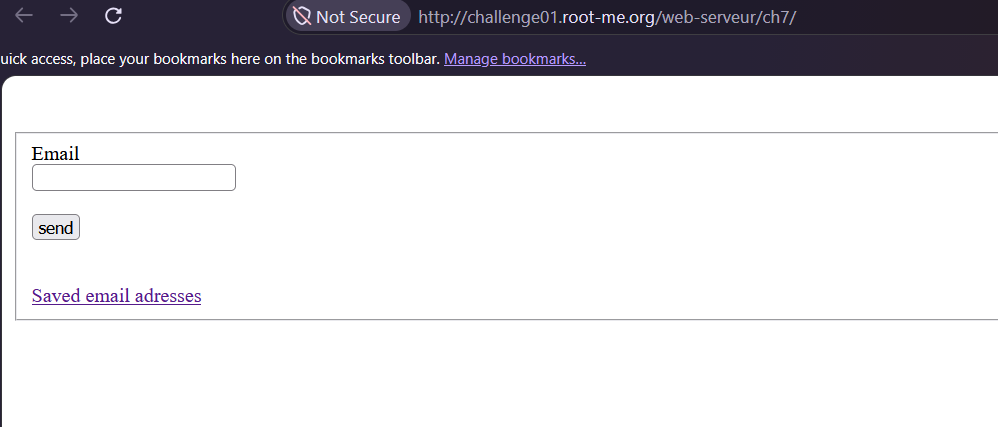
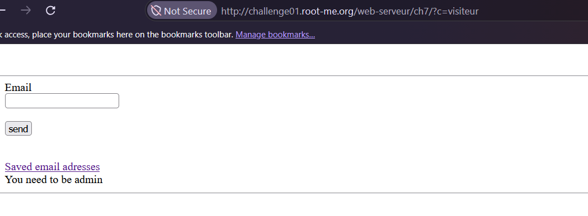
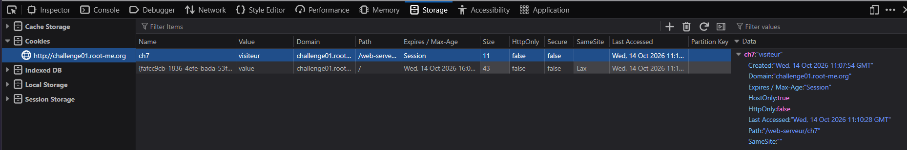
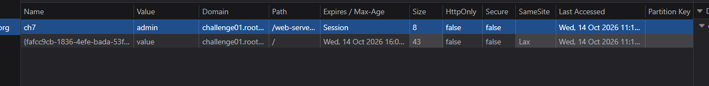
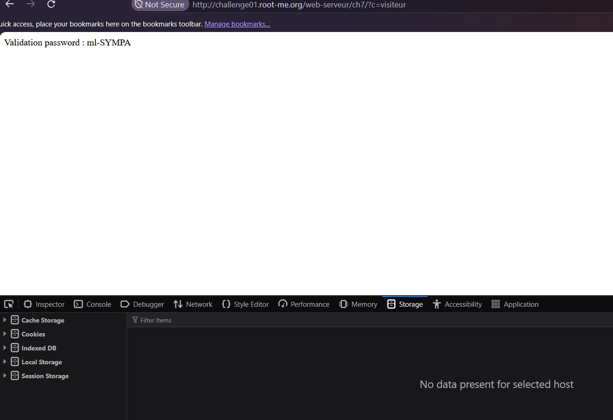

# HTTP - Cookies

**Category:** Web-Server · **Points:** 20 · **Author:** g0uZ · **Platform:** [Root-Me](https://www.root-me.org)

---

## 🇬🇧 English

### Statement
"Bob created a script in PHP to retrieve your email." A simple page lets a visitor submit an email address, with a link to view previously "saved email addresses":

> - Index: It seems that bob, the admin, loves cookies...

### Approach
Submitting an email works fine, but clicking "Saved email addresses" returns:

> You need to be admin

The challenge name and the hint ("Bob... loves cookies") both point directly at cookies as the access-control mechanism. Opening the browser DevTools **Storage** tab shows a cookie named `ch7` with the value `visiteur` ("visitor" in French):

Since this cookie is readable and editable client-side (no `HttpOnly` flag, no server-side session lookup backing it), I simply edited its value directly in DevTools from `visiteur` to `admin`:

Reloading the "saved email addresses" page with the modified cookie immediately grants access and reveals the validation password.

### Result
Password: `ml-SYMPA`

### Takeaway
A cookie is just a piece of text the client stores and sends back — if the server trusts its raw value (e.g. `role=admin`) as proof of identity/privilege without any server-side session validation (a signed token, a server-held session ID, etc.), then any user can simply edit that cookie in their own browser and grant themselves whatever role they want. Authorization decisions must always be verified against state the server controls, never against unsigned, client-editable values.

---

## 🇮🇷 فارسی

### صورت مسئله
«باب یه اسکریپت PHP نوشته که ایمیل شما رو ذخیره کنه.» یه صفحه‌ی ساده به بازدیدکننده اجازه میده یه ایمیل ثبت کنه، و یه لینک هم برای دیدن «ایمیل‌های ذخیره‌شده‌ی قبلی» وجود داره:

> - توضیح: به نظر میاد باب، ادمین، عاشق کوکیه...

### روش حل
ثبت ایمیل بدون مشکل انجام میشه، ولی کلیک روی «Saved email addresses» این پیام رو برمیگردونه:

> You need to be admin

هم اسم چلنج و هم سرنخش («باب... عاشق کوکیه») مستقیم به سمت کوکی‌ها به‌عنوان مکانیزم کنترل دسترسی اشاره میکنن - از تب **Storage** توی دیباگر مرورگر، یه کوکی به اسم `ch7` با مقدار `visiteur` (یعنی «بازدیدکننده» به فرانسوی) پیدا میکنیم:

چون این کوکی سمت کلاینت کاملاً قابل‌خوندن و قابل‌تغییره (نه flag مربوط به `HttpOnly` داره و نه پشتش یه session سمت سرور چک میشه)، مستقیم مقدارش رو توی DevTools از `visiteur` به `admin` تغییر میدم:

با رفرش کردن صفحه‌ی «ایمیل‌های ذخیره‌شده» با همین کوکی تغییریافته، بلافاصله دسترسی داده میشه و پسورد اعتبارسنجی نمایش داده میشه.

### نتیجه
پسورد: `ml-SYMPA`

### جمع‌بندی
یه کوکی فقط یه تکه متنه که کلاینت ذخیره میکنه و دوباره برمیگردونه - اگه سرور به مقدار خام اون (مثلاً `role=admin`) به‌عنوان اثبات هویت/دسترسی اعتماد کنه بدون هیچ اعتبارسنجی سمت سرور (مثل یه توکن امضاشده، یا یه session ID که سمت سرور نگه‌داری میشه)، اون‌وقت هر کاربری میتونه به‌سادگی توی مرورگر خودش اون کوکی رو تغییر بده و هر نقشی که بخواد به خودش بده. تصمیمات مربوط به دسترسی همیشه باید بر اساس چیزی که سمت سرور کنترل میشه تأیید بشن، نه بر اساس مقادیری که کلاینت بدون امضا میتونه آزادانه تغییر بده.
